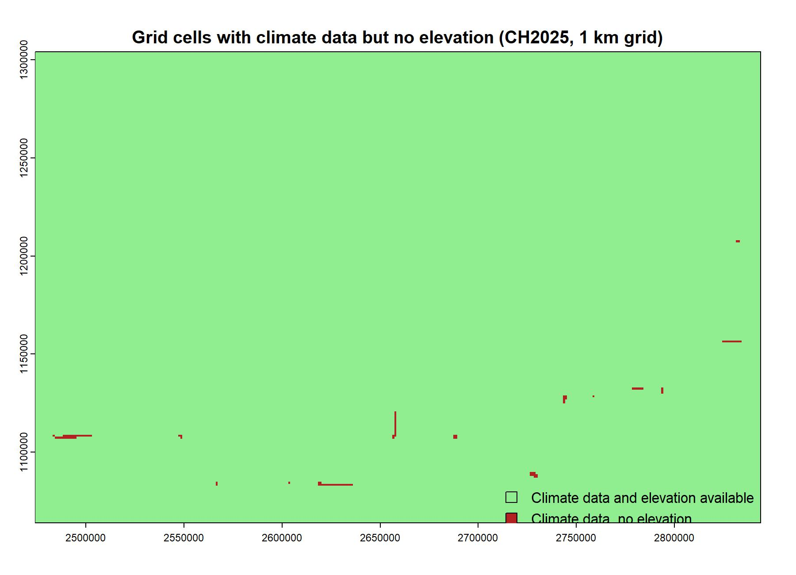

## Context

The summer of 2026 brought exceptional heat and dryness to large parts of Europe, with severe consequences for agriculture, forests, and grasslands. In Switzerland, 2026 was the strongest drought in the ERA5-Land reanalysis record since 1975, and an event of this magnitude would be expected only about twice per 1000 years in a climate without anthropogenic warming [@EuropeanDrought2026]. Meaningful drought projections must therefore look beyond long-term trends in precipitation. Drought impacts arise from the combined effect of several factors: the timing of precipitation events, changes in temperature and incoming solar radiation, and shifts in snow accumulation and snowmelt. These factors are particularly relevant for the response of forests and grasslands to drought. The most recent climate scenarios for Switzerland (CH2025) provide high-resolution projections of the climatic conditions that will shape future droughts. This thesis uses these projections to examine how climate warming alters the frequency and magnitude of drought across Switzerland. By doing so it provides information relevant to forest management, agriculture and water resource management. The resulting drought metrics can also serve as input for studies on forest fire risk and on how droughts affect vegetation productivity and carbon uptake.

## Objective

The aim of this thesis is to quantify how drought, expressed as the potential cumulative water deficit (PCWD), changes across Switzerland at different global warming levels (GWLs) in the CH2025 climate projections. I hypothesize that (1) the frequency and magnitude of drought events increase with global warming, with stronger increases at higher GWLs, and (2) the increase in absolute PCWD (mm) is spatially heterogeneous: strongest in the inner-Alpine dry valleys, followed by the Swiss Plateau, and weakest in the high Alps and the Alpine margins. Warming raises atmospheric water demand everywhere, mainly through a higher vapour pressure deficit [@ClimateCH2025Scientific]. Where precipitation is low, as in the inner-Alpine valleys, little water is available to compensate for this higher demand, so the deficit should grow fastest. In the high Alps, low temperatures and snowmelt supply buffer the increase, and the Alpine margins receive abundant precipitation. The results will be compared with the soil moisture and water availability droughts in the CH2025 Scientific Report [@ClimateCH2025Scientific], with the observed summer drying trends in Switzerland [@scherrerTrendsDriversRecent2022], and with the long-term drought variability of the past 600 years [@helpapAreModernDroughts2026].

## Materials and Methods

I investigate drought using the potential cumulative water deficit (PCWD) as defined by @helpapAreModernDroughts2026. Through PCWD, intensity and frequency of drought events are quantified. PCWD is calculated from daily precipitation, temperature, and radiation data. The analysis will be conducted for the GWLs 1.5, 2.0, 2.5 and 3.0 °C above pre-industrial levels, for all the available climate model simulations in the CH2025 dataset. The analysis is conducted on a 1 km grid across Switzerland, and results are aggregated to the biogeographic regions defined by the Swiss Federal Office for the Environment (FOEN) [@ClimateCH2025Scientific].

### Climate CH2025 datasets

The Climate CH2025 datasets are provided by the Swiss Federal Office for Meteorology and Climatology (MeteoSwiss) in two formats: gridded and local. The gridded data comprise daily time series of several meteorological variables on a high-resolution 1 km grid (DAILY-GRIDDED). Each simulation has one NetCDF file per variable and GWL. I.e. the NetCDF file for daily mean temperature with the simulation clmcom-cclm4-cccma and GWL1.5 is *ogd-climate-scenarios-ch2025-grid_ch_tas_clmcom-cclm4-cccma_gwl1.5.nc.*. the .nc file contains the value for that variable and GWL for every simulated day for 30 years (row) and for every grid cell (column). DAILY-LOCAL data is structured by stations. Each station has one .csv file covering the full spatial and temporal extent for every GWL and variable. I.e. the CSV file for daily mean temperature at the station Adelboden and GWL1.5 is *ogd-climate-scenarios-ch2025_ABO_tas_GWL1.5.csv.* The .csv file contains the value for that variable and GWL for every simulated day for 30 years (row) and for every Simulation (column). Files are also provided for the model reference period 1991-2020 for both DAILY-GRIDDED and DAILY-LOCAL @ClimateCH2025Datasets.

Simulations for pr, tas and rsds involving HADGEM are consistently missing 5 values per year, randomly distributed over the year. These missing values will be filled with the monthly mean of the respective variable.

### Calculating PCWD

PCWD is calculated as in @helpapAreModernDroughts2026. It is the cumulative difference between potential evapotranspiration (PET, $\mathrm{mm\ day}^{-1}$) and the liquid water infiltrating into the root zone ($P_{\mathrm{in}}$, $\mathrm{mm\ day}^{-1}$). $P_{\mathrm{in}}$ equals precipitation when air temperature is above 1 °C and no snow is present. Below 1 °C, precipitation accumulates as snow and $P_{\mathrm{in}} = 0$. Snow melt is simulated above 1 °C at a rate of 1 $\mathrm{mm\ day}^{-1}\ {}^{\circ}\mathrm{C}^{-1}$, so on days with snow cover $P_{\mathrm{in}}$ is precipitation plus snow melt. The daily water balance $P_{\mathrm{in}} - \mathrm{PET}$ is accumulated over successive days with a negative balance, and each such sequence is an event. An event is terminated, and the cumulative sum reset to zero, when PCWD falls 10 mm below the maximum PCWD reached earlier in the same event. For each event, the maximum PCWD and the event length (days) are recorded. Only the event with the largest PCWD in each calendar year is retained for further analysis. The calculation is implemented in the cwd R package [@stocker2026cwd].

#### Temperature

Temperature in °C can be used directly from the CH2025 DAILY-LOCAL and DAILY-GRIDDED data sets. The variables available are daily mean temperature (tas), daily minimum temperature (tasmin), and daily maximum temperature (tasmax).

#### Precipitation

Precipitation (pr) in mm can be used directly from the CH2025 DAILY-LOCAL and DAILY-GRIDDED data sets.

#### Snow

Snow, as required to calculate infiltration (liquid to soil), is not available directly from the CH2025 datasets. I apply the same method as @helpapAreModernDroughts2026 to solve this, splitting precipitation into rain (for days with mean temperature \> 1 °C) and snow (for days with mean temperature \< 1 °C). These variables are then fed into *simulate_snow* function of the *cwd* R package.

#### Radiation

PET according to the Priestley-Taylor equation is proportional to net radiation, i.e. the difference between incoming and outgoing shortwave and longwave radiation at the surface. CH2025 provides daily mean global radiation ($R_g$, $\mathrm{W\ m^{-2}}$) at 67 stations in DAILY-LOCAL (rsds), but no radiation at all in DAILY-GRIDDED. Net radiation ($R_n$) is therefore modelled from the variables that are available on the grid, in two steps.

In the first step, $R_g$ is predicted from precipitation (pr), daily minimum and maximum temperature (Tmin, Tmax) and the clear-sky shortwave radiation (Rsw-cc). Rsw-cc is calculated for each grid cell and day from latitude, terrain slope, aspect and solar declination with the function radiation_potentialRadiation of the R package meteoland [@decaceres2018]. The model is then trained on the CH2025 stations that provide $R_g$ together with precipitation, Tmin and Tmax (62 stations, 203–3294 m a.s.l.), using data from the reference period and all warming levels, so that the relationship covers past and future climatic conditions.

In the second step, $R_n$ is predicted from $R_g$, Tmin, Tmax, Prec and Rsw-cc. Observed $R_n$ is derived from SwissMetNet measurements as incoming minus reflected shortwave radiation plus incoming minus outgoing longwave radiation. The four SwissMetNet stations that measure all four components (Altdorf, Magadino, Payerne, Aadorf) serve as training data. 

For both steps, multiple linear regression, k-nearest neighbours and random forest are compared. Performance is assessed with leave-one-site-out cross-validation, so each model is evaluated at at least one station not used for training. The metrics are mean absolute error (MAE), root mean square error (RMSE), bias and $R^2$. The best model is applied to the DAILY-GRIDDED data to obtain $R_n$ for the PET calculation. 

#### Atmospheric Pressure

Atmospheric Pressure, as required to calculate PET, is not provided by the CH2025 DAILY-LOCAL and DAILY-GRIDDED data sets. I follow @helpapAreModernDroughts2026 approach, using the standard atmospheric pressure subject to elevation.

#### Elevation

CH2025 DAILY-GRIDDED Data is provided on a 1km grid. Metadata indicates that spatial resolution only covers the x and y axis, making it a two dimensional spatial representation. However, to calculate atmospheric pressure, elevation is needed. A raster is created matching the CH2025 DAILY-GRIDDED scale from the digital height model DHM25. DHM25 has a grid size of 200m with altitude interpolated from landeskarte 1:25000. DHM25 data is downscaled to 1km using the mean of the underlying 200m grid cells. Since DHM25 doesn't cover the full spatial extent of CH2025 DAILY-GRIDDED, a mismatch results. The mismatch is deemed irrelevant.



### Workflow

To calculate PCWD, the following workflow is applied:

1. **Prepare data for PCWD calculation**

1.1 Get data from CH2025 DAILY-GRIDDED dataset for every variable and every GWL, including the reference period 1991-2020. 

1.2 Fill missing values in HADGEM simulations with the monthly mean of the respective variable.

1.3 Get data from CH2025 DAILY-LOCAL dataset for all 62 stations that provide daily global radiation, temperature maximum, temperature minimum and precipitation for every GWL, including the reference period 1991-2020.

1.4 Calculate clear-sky shortwave radiation (Rsw-cc) using the approach explained above.

1.5 Calculate net radiation (Rn) using the approach explained above.

1.6 Calculate infiltration by splitting precipitation into snow and rain as explained above.

1.7  Calculate atmospheric pressure using the standard atmospheric pressure subject to elevation.

1.8  Calculate PET using PET function

1.9 Calculate water balance: liquid to soil minus evapotranspiration

2.  **Calculate daily potential cumulative water deficit and event-level maximum deficit and duration using cwd::cwd() as explained above.**

3. **Analyse results**

3.1 Quantify ensemble spread of PCWD for each GWL and biogeographic region over the 30 year period.
<details>
<summary>Click to show the regional aggregation map</summary>

```{r biogeo-map, echo=FALSE, message=FALSE, warning=FALSE, out.width="100%"}
library(leaflet)

leaflet() |>
  addProviderTiles(providers$Esri.WorldGrayCanvas) |>
  addWMSTiles("https://wms.geo.admin.ch/",
              layers      = "ch.bafu.biogeographische_regionen",
              options     = WMSTileOptions(format = "image/png", transparent = TRUE, opacity = 0.7),
              attribution = "Biogeographical regions: FOEN (BAFU) / geo.admin.ch") |>
  setView(lng = 8.2, lat = 46.8, zoom = 8)


3.2 Quantify maximum PCWD volume and event duration for each GWL and biogeographic region over the 30 year period.

3.3 Quantify the frequency of drought events exceeding a given PCWD threshold for each GWL and biogeographic region over the 30 year period.


## Proof of Concept

```{r cwd-ensemble-figure, echo=FALSE, out.width="100%", fig.cap="Daily cumulative water deficit across the EVO GWL 1.5 ensemble. The red line shows the ensemble median and the shaded band the 10th–90th percentile range."}
knitr::include_graphics(here::here("figures", "cwd_ensemble_EVO_GWL_1_5.png"))
```

## Scope

The thesis does not validate or bias-correct the datasets used. CH2025 is taken as provided, including its own bias adjustment and downscaling, and the SwissMetNet and MeteoSwiss radiation data are used as delivered. The model components that turn these data into PCWD are not validated either. I.e. the snow routine, the infiltration and the clear-sky radiation. The radiation model is trained on four stations. One fixed Priestley-Taylor coefficient is used. The thesis does not assess soil moisture, vegetation responses or drought impacts.

## Timeline

```{r timeline, echo=FALSE, message=FALSE, fig.width=9, fig.height=6.5}
library(tidyverse)

tl <- tribble(
  ~task,                                          ~start,       ~end,         ~type,
  "Drafting proposal",                            "2026-09-26", "2026-10-18", "Phase",
  "Interim meeting",                              "2026-10-08", NA,           "Milestone",
  "Evaluation proposal",                          "2026-10-19", "2026-10-20", "Phase",
  "Discussion proposal",                          "2026-10-20", NA,           "Milestone",
  "Data transformation",                          "2026-10-21", "2026-11-01", "Phase",
  "PCWD calculation",                             "2026-11-02", "2026-11-08", "Phase",
  "Visualisation",                                "2026-11-09", "2026-11-22", "Phase",
  "Ubelix first try",                             "2026-11-23", "2026-12-04", "Phase",
  "Ubelix second try",                            "2026-12-05", "2026-12-09", "Phase",
  "Analyse results",                              "2026-12-10", "2026-12-16", "Phase",
  "Report writing",                               "2026-12-17", "2026-12-26", "Phase",
  "Buffer",                                       "2026-12-27", "2027-01-02", "Phase",
  "Submit draft full paper",                      "2027-01-03", NA,           "Milestone",
  "Evaluation draft full paper",                  "2027-01-04", "2027-01-14", "Phase",
  "Discussion draft full paper",                  "2027-01-15", NA,           "Milestone",
  "Implementing feedback",                        "2027-01-16", "2027-01-28", "Phase",
  "Presentation to GECO group",                   "2027-01-25", NA,           "Milestone",
  "Ubelix",                                       "2027-01-29", "2027-02-04", "Phase",
  "Final submission",                             "2027-02-08", NA,           "Milestone",
  "Deadline grade entry autumn semester 2026 (?)", "2027-02-19", NA,          "Milestone"
) |>
  mutate(start = as.Date(start),
         end   = as.Date(end) + 1,          # include the last day in the bar
         task  = fct_rev(fct_inorder(task)))

ggplot(tl, aes(y = task, colour = type)) +
  geom_segment(data = filter(tl, type == "Phase"),
               aes(x = start, xend = end, yend = task),
               linewidth = 5) +
  geom_point(data = filter(tl, type == "Milestone"),
             aes(x = start), shape = 18, size = 4.5) +
  scale_colour_manual(values = c(Phase = "#2c7fb8", Milestone = "firebrick"),
                      name = NULL) +
  scale_x_date(date_breaks = "1 week", date_labels = "%d %b",
             expand = expansion(add = 3),
             sec.axis = dup_axis()) +
  scale_y_discrete(limits = levels(tl$task),
                 labels = scales::label_wrap(30)) +
  labs(x = NULL, y = NULL) +
  theme_minimal(base_size = 10) +
  theme(panel.grid.minor = element_blank(),
      panel.grid.major.y = element_line(colour = "grey92"),
      axis.text.x.bottom = element_text(angle = 45, hjust = 1),
      axis.text.x.top    = element_text(angle = 45, hjust = 0),
      legend.position = "top")
```

## Bibliography
